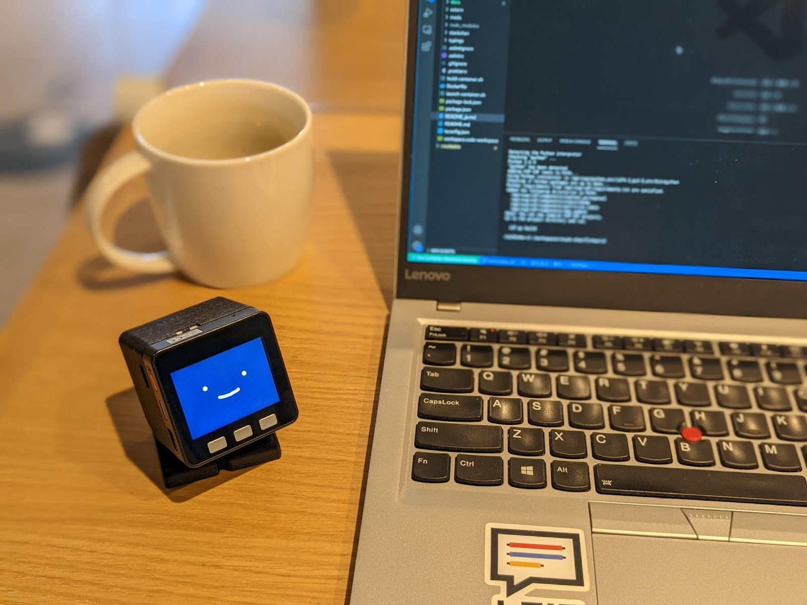
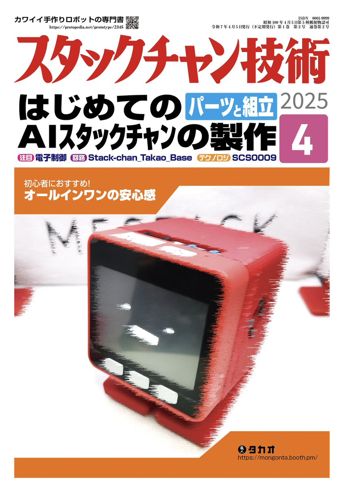
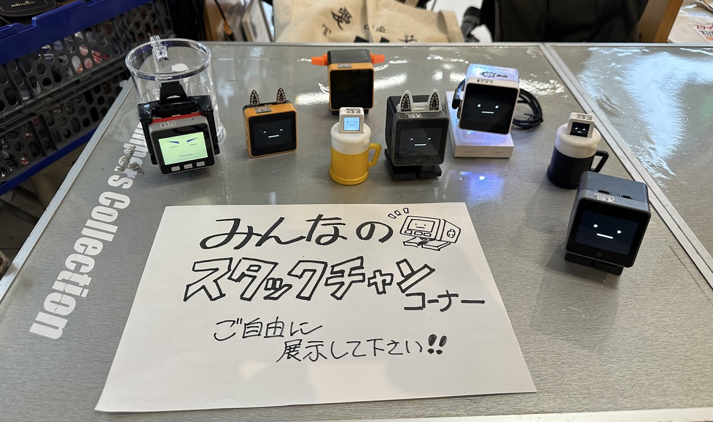
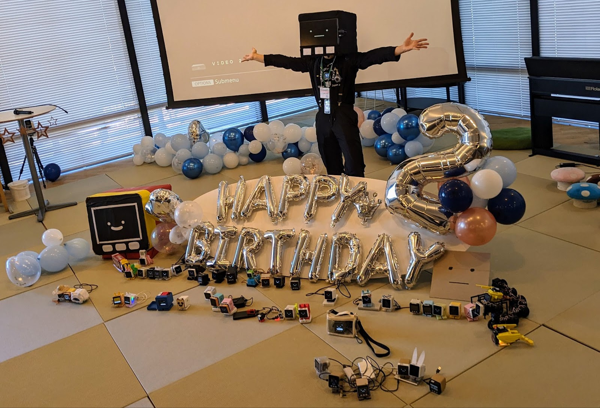
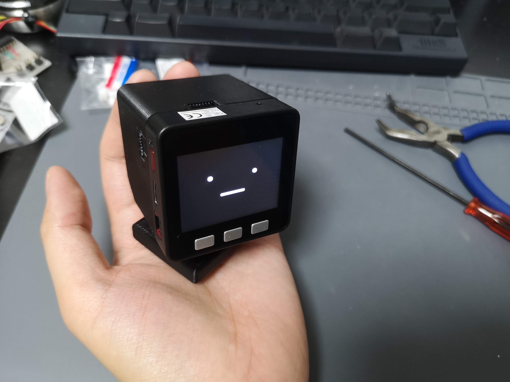
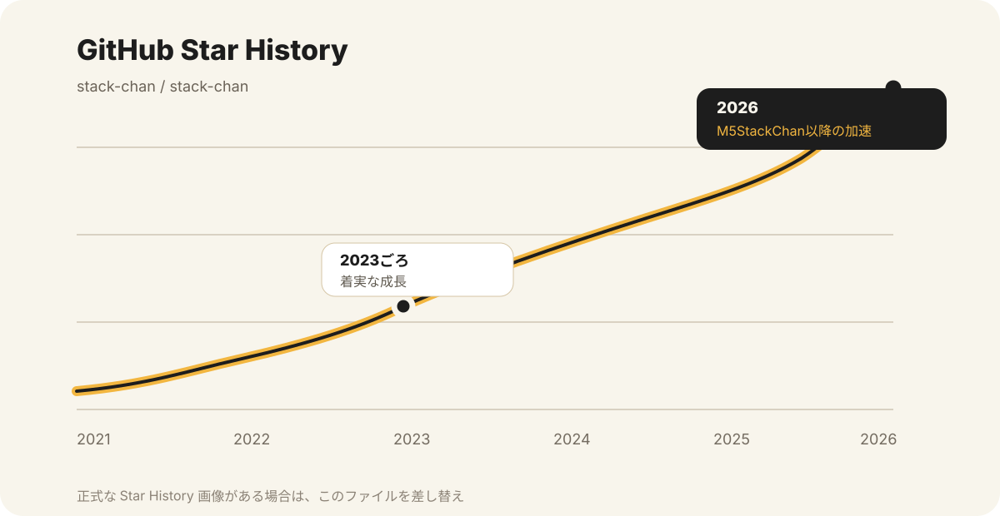
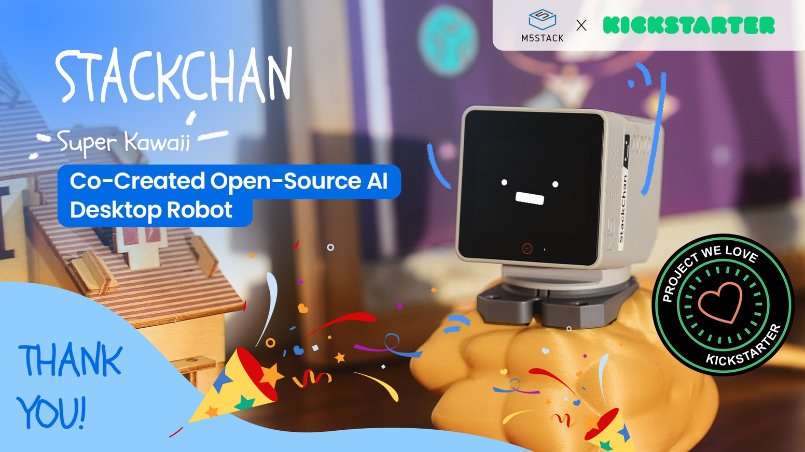
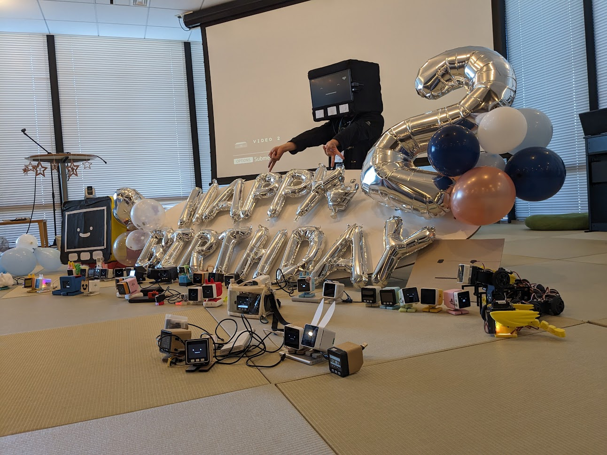

<!-- _class: cover -->

# ｽﾀｯｸﾁｬﾝの 今までとこれから

5歳、10カ年計画の折返し

5th Birthday 2026

<!--
今日はこの1年の振り返りと、後半5年の話をします。
ｽﾀｯｸﾁｬﾝは5歳になりました。10カ年計画で見ると、ここはちょうど折返し地点です。
-->

---

## 10カ年計画のちょうど折返し

  

    
2021

    
前半5年 生み出す・広げる

  

  

    
2026

    
<strong>5 years</strong> 折返し地点

  

  

    
2031

    
後半5年 社会に根づかせる・可能性を広げる

  

<!--
5周年は単なる通過点ではなく、節目です。
前半5年で種をまき、後半5年でそれを育てる。今日はその見立てで話します。
-->

---

## ひとりの工作から、みんなのロボットへ

  

    
<h3>OSSとして公開</h3>
作り方とコードを開き、誰でも触れる形にした。

    
<h3>コミュニティが成長</h3>
作例、改造、イベントが増え、参加の形が広がった。

    
<h3>学会誌にも登場</h3>
個人工作を越えて、技術文化として紹介されるようになった。

    
<h3>AI時代に再注目</h3>
LLMと身体をつなぐロボットとして見られ始めた。

  

  

    
    
    
    
  

<!--
最初はひとりの作例でした。
それがOSSとして公開され、作る人が増え、イベントや記事を通じて少しずつ文化になってきました。
-->

---

## 2025–2026は変化の年だった

  

01
<h3>学会誌</h3>
ｽﾀｯｸﾁｬﾝが技術コミュニティの外側にも紹介された。

  

02
<h3>LLMエージェント</h3>
対話だけでなく、行動するAIが身近になった。

  

03
<h3>バイブコーディング</h3>
ファームウェアもAIと一緒に書く時代になった。

  

04
<h3>M5StackChan</h3>
買って始められる入口が生まれた。

<!--
この1年は、技術面でも社会面でも一段ギアが上がった年でした。
LLMが身近になり、作り方も変わり、さらにM5StackChanによって入口が広がりました。
-->

---

## 世界に広がり始めたことが数字にも出てきた

  
  

    
<strong>2023ごろ</strong> 着実な成長

    
<strong>2026</strong> M5StackChan以降の加速

  

<!--
長く積み上げてきた流れがありつつ、直近で一段伸びました。
M5Stack版が入口を広げたことが、数字にも表れてきていると見ています。
正式なStar History画像があれば、この仮グラフを差し替えて使います。
-->

---

## M5StackChanが変えたこと

  

    <h3>Before</h3>
    
作れる人が作る

    
部品調達、組み立て、環境構築が参加の前提だった。

  

  

    
→

    
  

  

    <h3>After</h3>
    
買って始められる

    
安定供給、安価、再現性、本番利用の土台が見えてきた。

  

<!--
ただ売られた、という話ではありません。
参加の間口が広がり、将来的には社会実装や本番利用の可能性も見えてきたことが大きいです。
-->

---

## 広がったからこそ見えてきた課題

  
<h3>買った人と作る人の距離</h3>
購入から改造、参加までの導線をどう作るか。

  
<h3>ドキュメント整備</h3>
英語化、チュートリアル、最初の成功体験が必要。

  
<h3>供給・品質・保守</h3>
継続的に使えるロボットとしての期待に応える。

  
<h3>AI時代の品質担保</h3>
AIで作れるからこそ、安全性と再現性を設計する。

<!--
世界に開かれたことで、OSSとしての楽しさと、製品としてのわかりやすさの両立が必要になりました。
広がったからこそ、入り口から継続利用までを整える段階に来ています。
-->

---

## 後半5年の3つの方向性

  

01
<h3>社会実装</h3>
安定供給・安価が実現したら、本番プロダクトに使われるかもしれない。

  

02
<h3>個人のロボット入門</h3>
M5StackChanを入口に、アクセサリ作成、Unit基板実装、ソフト改変へ広げる。

  

03
<h3>ｽﾀｯｸﾁｬﾝが立つ？</h3>
LLM + ロボットの可能性。移動能力をもつｽﾀｯｸﾁｬﾝへ。

<!--
後半5年は、広げるだけでなく深めるフェーズだと思っています。
社会実装、入門機としての役割、そして身体性を持ったAIロボットとしての可能性。この3つを進めたいです。
-->

---

<!-- _class: closing -->

## この5年で話すようになった。 次の5年で、立つかもしれない。

  

    <strong>前半5年</strong>：誕生、OSS、コミュニティ、製品化 
    <strong>後半5年</strong>：社会実装、入門機、身体性
  

  

<!--
ｽﾀｯｸﾁｬﾝは5歳になりました。
10カ年計画で見ると、今はちょうど折返し地点です。
前半5年で、ｽﾀｯｸﾁｬﾝは生まれ、広がり、世界への入口を得ました。
後半5年では、社会実装されるロボットになり、個人のロボット入門になり、そしてLLM時代の身体を持つロボットへ進んでいくと思います。
-->
